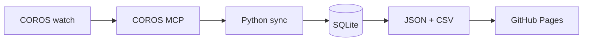

# zhubao315

**I turn everyday training into public, queryable data.**

Four self-hosted dashboards fed by one pipeline: COROS watch → SQLite → GitHub Pages.
No spreadsheets, no manual exports — every run, ride, hike and night of sleep lands in an open dataset.

---

## The four sites

| Site | What's in it | Scale |
| --- | --- | --- |
| **[Running](https://zhubao315.github.io/running/)** | GPS tracks, elevation, pace, 3D terrain | **1,983 runs · 24,545 km · 13 years** |
| **[Cycling](https://zhubao315.github.io/cycling/)** | Routes, speed, climbing, year-over-year | **5,072 rides · 35,246 km · 37,859 m climb** |
| **[Hiking](https://zhubao315.github.io/hiking/)** | Mountain routes with baked 3D scenes | **1,166 hikes · 3,182 km · 16,921 m climb** |
| **[Health](https://zhubao315.github.io/health/)** | Sleep stages, HRV, resting HR, stress, load | **1,024 days · 11 metrics · daily since 2023** |

Each site is a static page with no backend. The data is regenerated twice a day and committed to git, so history is versioned and every number is traceable back to a CSV row.

## How it works

`Python sync` handles retries, a descending window ladder for server caps, per-table watermarks and no-downgrade upserts. The dashboard, the Markdown report and the quality audit all read the same SQLite file, so they can never disagree.

## Engineering notes

The interesting part isn't the charts — it's keeping a personal dataset honest over time.

- **Missing ≠ zero.** A missing sleep stage stays `null` all the way to the chart. Pseudo-zeros are detected and reported, never silently filled.
- **Idempotent, lossless writes.** Re-fetching a day never overwrites stored values with `NULL` (`COALESCE(excluded, stored)`), so the archive can only grow.
- **Self-healing sync.** Each table tracks its own watermark; a failed fetch keeps the old watermark, so the next run re-reads the gap instead of skipping it.
- **Server caps are handled, not assumed.** "Last N days" APIs are probed with a descending window ladder; transient errors skip a window instead of killing the run.
- **Published audit.** `data_quality.json` reports missing rates, date gaps, duplicate keys and robust-z anomalies on every build.
- **Same definitions everywhere.** Rolling stats, baselines and correlations live in one module shared by the dashboard, the CLI and the Markdown report.

## Other things I build

| Project | What it is |
| --- | --- |
| **[investment-discipline](https://github.com/zhubao315/investment-discipline)** | Zero-dependency agent skill for investment research: collect → verify → analyze → discipline checks |
| **[knowledge-base-engineering-skill](https://github.com/zhubao315/knowledge-base-engineering-skill)** | Portable knowledge-base engineering skill for AI agents, read-only-first by design |
| **[perfectme](https://github.com/zhubao315/perfectme)** | An original 2D micro-animation pipeline (Qwen-Image × ACE-Step × Qwen) |

Mostly Python, TypeScript and a lot of YAML. I care about data that stays correct after the first month, and interfaces that stay readable after the tenth chart.

