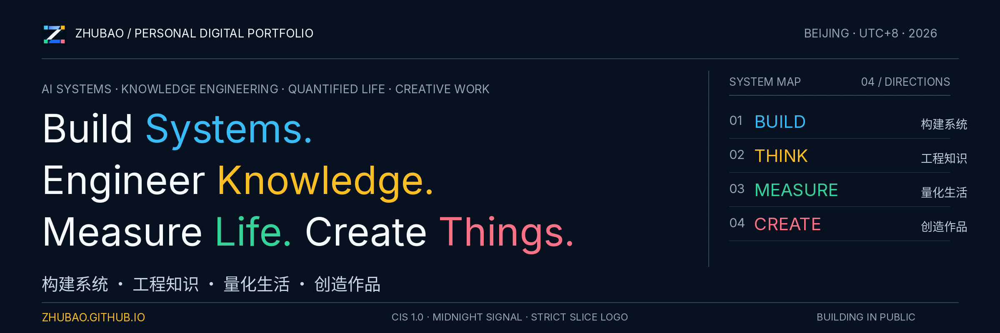

  <a href="https://zhubao315.github.io/work/"><strong>作品集</strong></a>
  &nbsp;·&nbsp;
  <a href="https://zhubao315.github.io/about/">关于</a>
  &nbsp;·&nbsp;
  <a href="https://zhubao315.github.io/think/">思考</a>
  &nbsp;·&nbsp;
  <a href="https://zhubao315.github.io/brand/"><strong>品牌 CIS</strong></a>
  &nbsp;·&nbsp;
  <a href="https://zhubao315.github.io/health/">健康</a>
  <a href="https://zhubao315.github.io/running/">跑步</a>
  <a href="https://zhubao315.github.io/cycling/">骑行</a>
  <a href="https://zhubao315.github.io/hiking/">徒步</a>
  &nbsp;·&nbsp;
  <a href="https://x.com/zhubao315">X</a>

## 把方法做成系统，把生活记录成数据

我做 AI 与 Agent 工程、数字产品、知识工程与投资研究，也长期记录自己的健康与运动。

作品集里没有“领先”“颠覆”这类形容词，只有公开代码、可访问的站点、可复核的数字，以及每个项目主动写明的边界。18 个案例、6 个旗舰项目，全部标注来源类型与最后核验日期。

**[进入作品集 →](https://zhubao315.github.io)**

---

## 品牌系统

- **ZHUBAO CIS 1.0 · Midnight Signal**：个人品牌全量识别系统（CI / VI / SI），已发布在 [zhubao315.github.io/brand/](https://zhubao315.github.io/brand/)。Logo 权威版为品牌板**严格切图**（零重绘）；[智能体提示词](https://zhubao315.github.io/brand/AGENT-PROMPT.md) 可直接调用。
- **ACTIVE 2.0 · 运动与健康四站**：健康 / 跑步 / 骑行 / 徒步共用统一 Header、导航、Token 与页脚；规范源在 [active-watch](https://github.com/zhubao315/active-watch)。顶部只保留四站导航与主题切换，GitHub 入口仅在页脚。

## 四个方向

| # | 方向 | 在做什么 |
|:--:|---|---|
| 01 | **BUILD** · 构建系统 | AI、Agent Skills、软件架构与云原生基础设施。把方法做成可运行、可治理的系统。 |
| 02 | **THINK** · 探索认知 | 知识工程、投资研究与持续学习。让信息经过结构、证据与纪律，变成可调用的资产。 |
| 03 | **MEASURE** · 量化生活 | 健康、跑步、骑行与徒步。用十多年的个人数据，记录身体与时间的关系。 |
| 04 | **CREATE** · 创造作品 | 数字产品、人格探索与 AI 动画。把抽象的想法变成可以体验、观看和分享的作品。 |

## 六个旗舰项目

**01 · [MBTI64](https://zhubao315.github.io/work/mbti64/)** — 64 型人格稀有度测评  
120 道中文情景题 → 六维计分 → 64 型人格与 7 档稀有度。答案只在浏览器本地计算。  
`120 道题` `64 型` `254 项测试` — [在线测评](https://zhubao315.github.io/mbti64/) · [源码](https://github.com/zhubao315/mbti64)

**02 · [uSkill](https://zhubao315.github.io/work/uskill/)** — Agent 标准化技能底座  
SOP → 标准化 Skill → 可调用执行器，一条可复用的能力工程链路。  
`v1.1` `4 项能力属性` `Schema / CLI / Python API / Executor` — [源码](https://github.com/zhubao315/uSkill)

**03 · [Knowledge Base Engineering](https://zhubao315.github.io/work/knowledge-base-engineering/)** — 知识库工程  
只读优先的 AI Skill：诊断、准入、治理、度量与可回滚的运营。物理删除不在 AI 权限集合。  
`v1.2.0` `8 个治理模块` `25 项回归测试` — [源码](https://github.com/zhubao315/knowledge-base-engineering-skill)

**04 · [Investment Discipline](https://zhubao315.github.io/work/investment-discipline/)** — 投资的纪律  
不预测市场，只把决策过程变成可执行清单。不荐股、不承诺收益。  
`8 种任务模式` `45 项结构校验` `63 项单元测试` — [源码](https://github.com/zhubao315/investment-discipline)

**05 · [Quantified Life](https://zhubao315.github.io/work/quantified-life/)** — 量化生活  
COROS → SQLite → 静态站点。健康、跑步、骑行与徒步四个独立面板。  
`1,039 天健康数据` `2,037 次跑步 / 24,548 km` `5,776 次骑行 / 45,291 km` `344 次徒步 / 2,694 km / 53,014 m 爬升`  
[健康](https://zhubao315.github.io/health/) · [跑步](https://zhubao315.github.io/running/) · [骑行](https://zhubao315.github.io/cycling/) · [徒步](https://zhubao315.github.io/hiking/)  
四站合计 8,157 次运动 / 72,533 km，为由公开快照相加的派生值。

**06 · [Perfect Me](https://zhubao315.github.io/work/perfectme/)** — 满分的我  
一部关于“被喜欢”与“做自己”的原创 2D 微动漫。3 名原创角色，从剧本、分镜到成片的完整制作链路；AI 辅助视觉与音频，制作过程与复现脚本在仓库公开。  
`2′31″` `3 个角色` `1 条完整制作管线` — [观看](https://zhubao315.github.io/perfectme/) · [源码](https://github.com/zhubao315/perfectme)

## 工作方式

1. **先定义问题，再选择工具。** 先确认边界、证据和验收方式，再决定要不要引入新的框架。
2. **可验证，比看起来聪明更重要。** 让结果能被复跑、被审计、被回滚；对数据缺失、证据不足和失败路径保持诚实。
3. **把经验沉淀成系统。** 一次性的 Prompt 是消耗品，可复用、可调用、可迭代的 Skill 才是资产。
4. **长期记录，持续复利。** 身体、知识和作品都需要时间尺度。可信的长期数据，比任何单点高光更有价值。

## 写作

两部书稿在作品集中以**手稿**状态呈现，不是已出版图书：

- **《知识库工程学》** — 从收藏到可治理的知识系统。13 章、5 个附录，配套 Skill v1.2.0。
- **《投资的纪律》** — 从情绪交易到纪律复利。8 种任务模式、45 项检查、63 项测试，配套 Skill 已开源。

没有可核实的 ISBN、出版社或发行信息，因此不称为已出版。阅读笔记与方法记录在 [THINK](https://zhubao315.github.io/think/)。

## 公开记录

`61` 个公开仓库 · `24` 个非 Fork · `37` 个 Fork / 上游研究

Fork 与上游项目只作为研究样本，不计入原创作品。每个案例页都标注 **原创 / 二次开发 / 上游研究**，以及最后核验日期。

数据快照 2026-11-11 · 站点与仓库的实时状态以各自页面为准

---

  <a href="https://zhubao315.github.io">作品集</a>
  &nbsp;·&nbsp;
  <a href="https://zhubao315.github.io/work/">全部项目</a>
  &nbsp;·&nbsp;
  <a href="https://zhubao315.github.io/about/">关于</a>
  &nbsp;·&nbsp;
  <a href="https://zhubao315.github.io/brand/">品牌 CIS</a>
  &nbsp;·&nbsp;
  <a href="https://github.com/zhubao315/active-watch">ACTIVE 2.0</a>
  &nbsp;·&nbsp;
  <a href="https://github.com/zhubao315?tab=repositories">GitHub 仓库</a>

